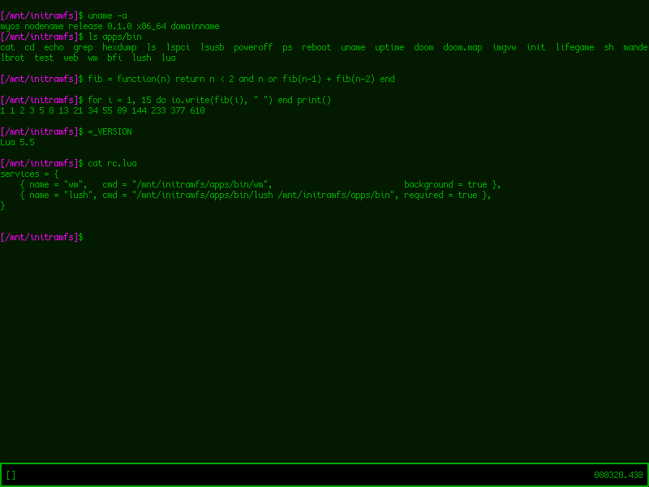
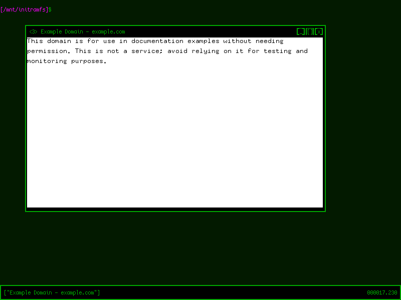
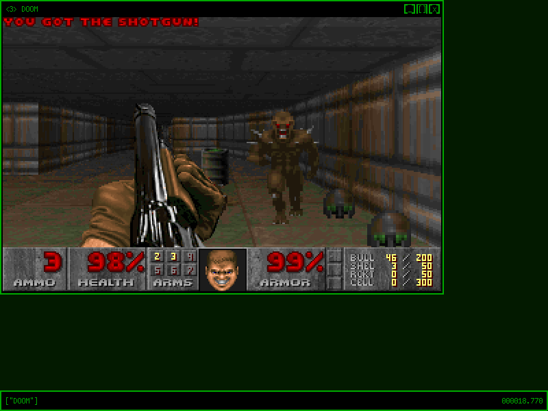
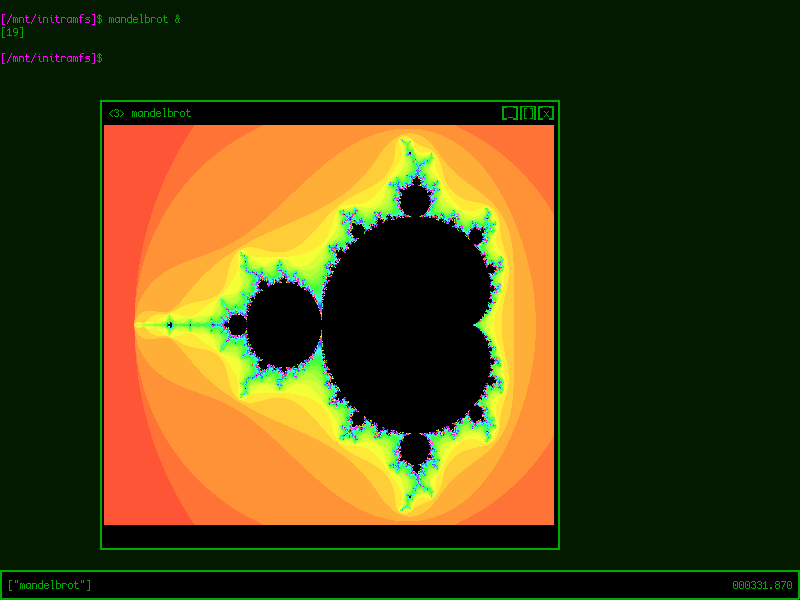
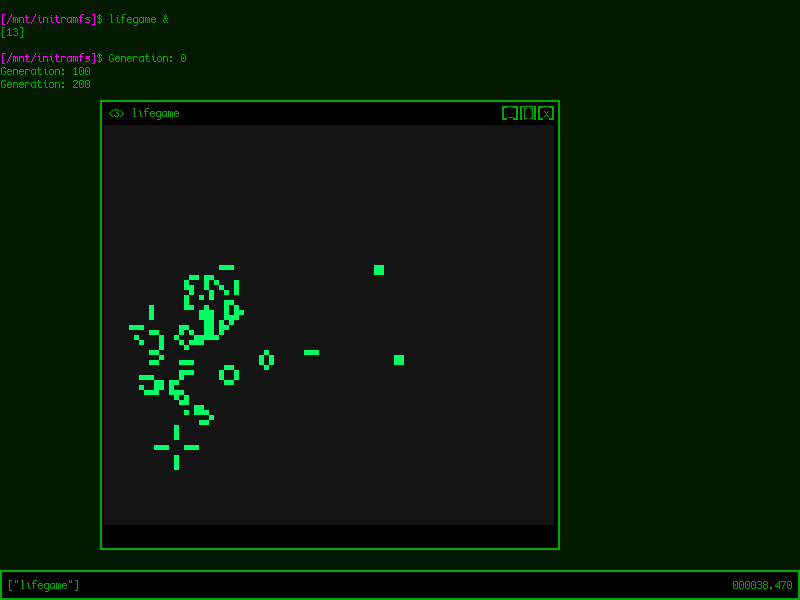

# myos-x86_64

[](LICENSE)

[](https://deepwiki.com/zakki0925224/myos-x86_64)

**myos-x86_64** is a hobby operating system written in Rust.

This is a replacement project for the previous **[myos](https://github.com/zakki0925224/myos)**.

## Features

- [x] Written in Rust
- [x] My own UEFI boot loader using [uefi-rs](https://github.com/rust-osdev/uefi-rs)
- [x] x86_64 kernel
- [x] Paging
- [x] Multitasking
    - [x] Simple priority-based executor (for Rust's async runtime)
    - [x] Multi task scheduler (for userland tasks)
- Bus support
    - [x] PCI
    - [x] USB (xHCI)
- Device support
    - [x] PS/2 Keyboard and Mouse
    - [x] UART 16550A
    - [x] RTL8139
    - [x] PC Speaker
    - [x] USB HID Keyboard
    - [x] USB HID Tablet
- Timer support
    - [x] Local APIC timer (main timer)
    - [x] ACPI PM timer
    - [x] TSC
- File system
    - [x] VFS (Virtual File System)
    - [x] FAT32 (Read only)
    - [x] Device file system (/dev)
    - [x] Process file system (/proc)
    - [x] Initramfs (FAT32, read/write in memory)
- Networking
    - [x] Ethernet (Raw frames)
    - [x] ARP
    - [x] IPv4
    - [x] ICMP
    - [x] UDP
    - [x] TCP
    - [x] Socket API
- Window Manager
- [Userland applications](/apps/) implemented in C or Rust (libc for myos available [here](/apps/libc/))
    - sh - basic shell
    - lush - Lua-powered shell
    - Web browser
    - DOOM
    - Lua interpreter
    - and others...

## Screenshots

<table>
  <tr>
    <td align="center"><br>lush (Lua shell)</td>
    <td align="center"><br>Web browser</td>
  </tr>
  <tr>
    <td align="center"><br>DOOM</td>
    <td align="center"><br>Mandelbrot</td>
  </tr>
  <tr>
    <td align="center"><br>Game of Life</td>
    <td></td>
  </tr>
</table>

## Third party

- OVMF from [EDK II](https://github.com/tianocore/edk2.git) (included)
- [Cozette](https://github.com/the-moonwitch/Cozette.git) (download released binary when build)
- [QEMU](https://gitlab.com/qemu-project/qemu.git) (for debugging)
- [doom-for-myos](https://github.com/zakki0925224/doom-for-myos) (forked from [ozkl/doomgeneric](https://github.com/ozkl/doomgeneric))
- [lua-for-myos](https://github.com/zakki0925224/lua-for-myos) (forked from [lua/lua](https://github.com/lua/lua))
- [doom1.wad](https://github.com/Akbar30Bill/DOOM_wads/blob/master/doom1.wad)

## Getting started

### Requirements

- Linux host (tested on Ubuntu; WSL2 works)
- `sudo` (disk images are built with loop mounts)
- KVM access (`/dev/kvm`; QEMU runs with `-accel kvm`)
- [rustup](https://rustup.rs/) - the pinned nightly toolchain in `rust-toolchain.toml` is installed automatically

### Packages

```bash
$ sudo apt update && sudo apt install \
    git python3 wget build-essential lld libclang-dev \
    qemu-system-x86 qemu-utils dosfstools bdf2psf
```

| Package                         | Used for                                                                                                      |
| ------------------------------- | ------------------------------------------------------------------------------------------------------------- |
| `build-essential`               | C apps (libc, lush, DOOM, Lua), `objdump`                                                                     |
| `lld`                           | Linking userland apps                                                                                         |
| `libclang-dev`                  | `bindgen` in `libc-rs`                                                                                        |
| `qemu-system-x86`, `qemu-utils` | Running the OS, creating the disk image                                                                       |
| `dosfstools`                    | Formatting FAT32 images                                                                                       |
| `bdf2psf`                       | Converting Cozette to PSF (workaround for [Cozette#112](https://github.com/the-moonwitch/Cozette/issues/112)) |

<details>
<summary>Optional packages</summary>

- Debugging: `telnet` (QEMU monitor), `gdb` (`rust-gdb`)
- Building QEMU from source (only when `USE_OWN_QEMU = True` in `task.py`): `ninja-build meson pkg-config python3-venv libglib2.0-dev libsdl2-dev libslirp-dev`

</details>

### Build and run

```bash
$ git clone https://github.com/zakki0925224/myos-x86_64.git
$ cd myos-x86_64
$ python3 ./task.py run
```

Submodules, the Cozette font and `doom1.wad` are fetched automatically on the first build.

After booting, `lush` (a Lua-powered shell) starts. Try:

```
[/mnt/initramfs]$ doom &
[/mnt/initramfs]$ web example.com &
[/mnt/initramfs]$ mandelbrot &
[/mnt/initramfs]$ =1 + 2
```

> [!NOTE]
> The keyboard layout is JIS (Japanese 109 keys).

## Tasks

Run `python3 ./task.py <task>`. Running without an argument prints the list of tasks.

| Task            | Description                                                           |
| --------------- | --------------------------------------------------------------------- |
| `build`         | Build the bootloader, kernel and apps                                 |
| `run`           | Build and run in QEMU                                                 |
| `run_nographic` | Run without a display (serial only)                                   |
| `run_with_gdb`  | Run and wait for a GDB connection on `:3333`                          |
| `gdb`           | Attach `rust-gdb` to a running QEMU                                   |
| `monitor`       | Connect to the QEMU monitor (`telnet localhost 5678`)                 |
| `make_iso`      | Create `build/myos.iso` for real hardware                             |
| `dump`          | Disassemble the kernel and bootloader into `dump/`                    |
| `webserver`     | Start a test HTTP server, reachable from the guest at `10.0.2.2:8888` |
| `clean`         | Remove build artifacts                                                |

## Kernel tests

```bash
$ cd kernel
$ cargo test
```
